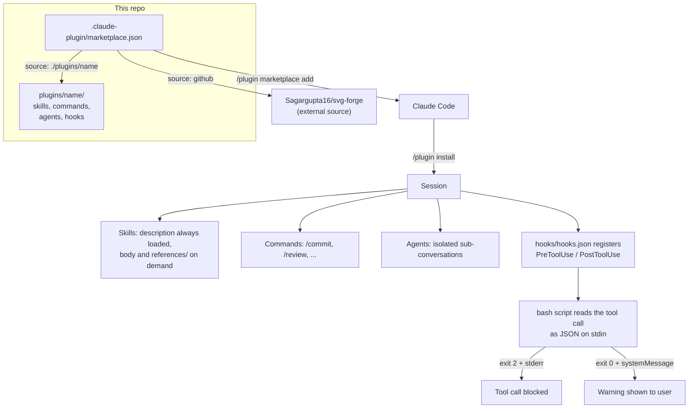

# Claude Skills

[](LICENSE)
[](#plugins)
[](CHANGELOG.md)
[](https://github.com/Sagargupta16/claude-skills/actions)

Focused Claude Code plugin marketplace. 16 plugins covering everyday dev workflow, git, open-source contributions, Docker, dependency audits, repo hygiene, refactoring, FARM stack, context management, diff explanation, debug triage, Renovate triage, end-of-session audit, Python clean code, and animation/motion.

Plugins are individually installable. Pick the ones relevant to your stack.

## Quick start

```text
/plugin marketplace add Sagargupta16/claude-skills
/plugin install dev-rules@sagar-dev-skills
```

Restart Claude Code. `dev-rules` now blocks `git push --force` to `main` and commits that stage an API key, and warns on direct commits to `main`. The hooks need `jq` on your PATH.

## Tested guardrail hooks

<picture>
  <source media="(prefers-color-scheme: dark)" srcset="docs/demo/hooks-demo-dark.svg">
  <source media="(prefers-color-scheme: light)" srcset="docs/demo/hooks-demo-light.svg">
  
</picture>

Every line above is real output. [`scripts/demo.sh`](scripts/demo.sh) feeds those four commands to the hooks in a throwaway repo, and CI fails if what the hooks print stops matching the [committed transcript](docs/demo/hooks-demo.json). The animation is rendered from that transcript with [svg-forge](https://github.com/Sagargupta16/svg-forge); [docs/demo/README.md](docs/demo/README.md) has the commands.

The six hooks run against [`tests/hooks/run.sh`](tests/hooks/run.sh), a table of 88 fixture cases on every pull request. Each case pipes a real payload into the hook on stdin, inside a scratch git repo with real branches, staged blobs, commits and an upstream remote, and expects `block` (exit 2), `warn` (exit 0 with a `systemMessage`) or `allow` (exit 0, silent).

| Hook | Cases | What they cover |
|------|------:|-----------------|
| secret-guard | 31 | 15 credential forms, `commit -a`, staged vs working copy, chained commands, false positives |
| no-force-push | 28 | `-f`, `--force-with-lease`, `+refspec`, `src:main`, `HEAD`, `-fu`, `--all`, feature branches |
| commit-lint | 12 | breaking-change `!`, scopes, unknown types, subjects over 72 chars |
| auto-format | 7 | formatter detection, a formatter that fails, missing files |
| branch-guard | 5 | `main`, `master`, feature branches, `grep "git commit"` |
| upstream-sync-check | 5 | no upstream, level, 2 commits behind, look-alike commands |

The same suite can replay any older release with `--ref`, which is how the earlier hook bugs show up as numbers:

| Hooks at | Cases passed | Why the rest fail |
|----------|-------------:|-------------------|
| `v5.2.0` | 31 / 88 | hooks read argv instead of stdin and blocked with `exit 1`, which does not block |
| 5.3.0 (`d4256ed`) | 71 / 88 | `\s` and `\x27` inside `grep -E` brackets, missing token formats, `HEAD` and `-fu` force pushes, `feat!:` |
| 5.4.0 (`83bbe07`) | 71 / 88 | same hooks as 5.3.0 |
| 5.4.1 and later | 88 / 88 | |

```bash
bash tests/hooks/run.sh              # the hooks in this checkout
bash tests/hooks/run.sh --ref v5.2.0 # the hooks at any git ref
```

## Where to start

Sixteen plugins is a lot to read. Start with these four:

- **`dev-rules`** -- the tested hooks above, plus a guardrail skill for git safety, secrets, PR workflow and dependencies.
- **`starter-session-audit`** -- at the end of a session, scans the conversation for corrections, preferences and decisions you never saved, and proposes where to save each.
- **`renovate-triage`** -- sorts every open Renovate PR across your repos into merge, close or defer.
- **`svg-forge`** (external) -- animated README cards and diagrams that survive GitHub's image proxy. The demo above was made with it.

## Philosophy

This marketplace encodes an opinionated workflow developed across 60+ repos and active open-source contributions: terse commits, scoped PRs, no force-pushes to main, no `git add .`, no `Co-Authored-By` trailers, real feature verification over "type-check passes," and a 7+/10 quality bar before opening upstream PRs.

Most plugins are language-agnostic and adapt to your stack (Python, Node, Go, Rust, etc.). A few are intentionally narrow:

- **`farm-stack`** -- FastAPI + React + MongoDB only. Skip if you're not on that stack.
- **`oss-contrib`** -- assumes GitHub + `gh` CLI.
- **`context-management`, `starter-session-audit`** -- about Claude Code itself. Useful if you use Claude Code. Not portable to other AI coding tools.

**5.0.0 cull:** this marketplace went from 25 plugins to 14 on 2026-05-13. Removed plugins that duplicated Anthropic-official skills (`planning`, `methodology`, `verification`), that sat idle (`api-design`, `testing`, `database`, `ci-cd`, `infrastructure`, `performance`, `security-hardening`, `logging-observability`), or that overlapped each other (`documentation`, `session-management`, `claude-md-generator`, `monorepo`). See [CHANGELOG.md](CHANGELOG.md) for the full list.

## Plugins

### Development Essentials

| Plugin | Commands | Agents | Hooks | What It Does |
|--------|----------|--------|-------|-------------|
| **dev-workflow** | `/commit`, `/review`, `/test`, `/fix`, `/pr`, `/status`, `/check-pr` | code-reviewer, debugger | auto-format | Everyday dev commands. Commands use `!` dynamic context injection for grounded first-attempt responses. |
| **dev-rules** | _(auto-activates)_ | guardrail-checker | secret-guard, no-force-push, branch-guard | Guardrails: git safety, security, PR workflow, context optimization, CLAUDE.md authoring |
| **refactoring** | `/refactor` | refactorer | - | Code smell detection, extract/rename/move, migration patterns (JS->TS, CJS->ESM) |
| **git-advanced** | `/resolve-conflict` | git-assistant | commit-lint | Rebase, cherry-pick, bisect, stash, conflict resolution, undo |
| **diff-explain** | _(skill only)_ | - | - | One-paragraph plain-English summary of a diff. Groups by concern, flags risks. |
| **debug-triage** | _(skill only)_ | - | - | Cause-fix-test triage from a pasted stack trace. No lectures. |
| **clean-code** | _(skill only)_ | - | - | Boy Scout Rule + Robert Martin's full Clean Code catalog for Python. Violations flagged by rule ID. |

### Stack-Specific

| Plugin | Commands | Agents | Hooks | What It Does |
|--------|----------|--------|-------|-------------|
| **farm-stack** | `/scaffold-farm` | farm-scaffolder | - | FastAPI + React + MongoDB patterns, project scaffolding, config, Docker |
| **docker-deploy** | `/dockerize` | dockerfile-optimizer | - | Multi-stage Dockerfiles, compose patterns, image optimization, security |
| **motion** | `/motion audit\|add\|fix` | - | - | Animation in three modes: 12-principles audit, add micro-interactions, fix jank |

### Security & Dependencies

| Plugin | Commands | Agents | Hooks | What It Does |
|--------|----------|--------|-------|-------------|
| **deps-audit** | `/audit-deps` | dependency-auditor | - | Vulnerability scanning, outdated packages, unused deps, update strategies |
| **renovate-triage** | _(skill only)_ | - | - | Batch-triage open Renovate PRs across all your repos into merge / close / defer |

### Open Source and Maintenance

| Plugin | Commands | Agents | Hooks | What It Does |
|--------|----------|--------|-------|-------------|
| **oss-contrib** | `/sync-upstream`, `/prep-pr` | pr-analyzer | upstream-sync-check | Fork sync, upstream compliance, CLA/DCO signing, AI disclosure, PR quality bar |
| **repo-polish** | `/polish-repo` | repo-auditor | - | .gitignore, .env.example, README, LICENSE generation, secret detection, CLAUDE.md auditing |

### Claude Code Meta

| Plugin | Commands | Agents | Hooks | What It Does |
|--------|----------|--------|-------|-------------|
| **context-management** | `/manage-context` | context-advisor | - | Context rot detection, compaction timing, branching strategy, sub-agent isolation |
| **starter-session-audit** | _(skill only)_ | - | - | End-of-session audit. Scans conversation for uncaptured corrections, preferences, decisions; proposes where to save each. |

### External Plugins

Listed here, built and validated in their own repos. The marketplace entry points at the repo, so `/plugin install` fetches it from there.

| Plugin | Skills | Agents | Hooks | What It Does |
|--------|--------|--------|-------|-------------|
| **[svg-forge](https://github.com/Sagargupta16/svg-forge)** | `animated-svg`, `motion-scene`, `svg-audit` | svg-designer | - | Animated SVGs that render everywhere: README cards, banners, loaders and diagrams that survive GitHub's image proxy, plus React and Motion scenes. Ships a generator for 14 kinds with 15 contrast-checked themes, a WCAG contrast validator and a frame renderer. |
| **[orrery](https://github.com/Sagargupta16/orrery)** | `orrery` | planner, diagram-author, image-importer, patch-proposer, accuracy-reviewer, conventions-reviewer, flow-reviewer, legibility-reviewer | - | Architecture, system design and business flow diagrams from a short YAML spec with the official AWS, Azure, Google Cloud, Kubernetes, GitHub and IBM icons plus 5,500 tech logos, rendered to SVG, PNG, draw.io, React TSX, HTML and design documents. Bundled CLI (Node 22+), a validator with fixes, `/orrery:draw`, `/orrery:doc`, `/orrery:import-image` and a measured `/orrery:review` loop. [Gallery](https://sagargupta.online/orrery/gallery/). |

## Component Types

| Type | Count | What It Does |
|------|-------|-------------|
| **Skills** | 16 | Background knowledge that auto-activates based on context |
| **Commands** | 16 | User-invocable slash commands (`/commit`, `/test`, etc.) |
| **Agents** | 11 | Autonomous sub-conversations for code review, debugging, scanning |
| **Hooks** | 6 | Shell scripts registered in the plugin's `hooks/hooks.json` and run by Claude Code on tool events (block secrets, validate commits, etc.) |

Counts cover the 16 plugins in this repo; external plugins carry their own counts.

## How It Works



- **Content only, no runtime.** Everything is Markdown, JSON and bash. Claude Code is the runtime; this repo only ships what it loads.
- **Progressive disclosure.** A skill's `description` is the only part always in context, so each one starts with `Use when ...` to say exactly when it should fire. Long rule sets (`clean-code`, `motion`) live in `references/` and load only when the skill needs them.
- **Hooks follow Claude Code's contract, not a guess at it.** Each script is registered in `hooks/hooks.json`, reads the tool call as JSON on stdin and warns through a `systemMessage` JSON object. The five Bash hooks also gate on `hook_event_name` and `tool_name` and split the command on shell separators so `grep "git commit"` does not trigger them, and the two that stop a call (`secret-guard`, `no-force-push`) block with `exit 2`. `auto-format` runs on `Write|Edit` and never blocks. 5.3.0 is the release where all six hooks were found inert and rewired; the [CHANGELOG](CHANGELOG.md) has the full story.
- **External plugins stay in their own repo.** `svg-forge` is listed with a `github` source, so it is versioned, tested and released on its own while installing from this marketplace.
- **CI guards the format.** Every pull request and every push to `main` runs [`scripts/validate-plugins.sh`](scripts/validate-plugins.sh) (manifests, frontmatter, hook registration against the real event list), [skillcheck](https://github.com/Sagargupta16/skillcheck) (Agent Skills spec lint), [`scripts/check-links.sh`](scripts/check-links.sh) (relative links across every tracked Markdown file), the [hook test suite](tests/hooks/run.sh) and a diff of the demo transcript against what the hooks print today.
- **Each new version becomes a release.** When `Validate Plugins` passes on `main`, the [Release workflow](.github/workflows/release.yml) reads `metadata.version` from `marketplace.json` and, if `v<version>` does not exist yet, tags that commit and publishes a GitHub Release whose notes are that version's CHANGELOG section ([`scripts/release-notes.sh`](scripts/release-notes.sh)).

Run the same gates locally:

```bash
bash scripts/validate-plugins.sh
bash scripts/check-links.sh
bash tests/hooks/run.sh
bash scripts/demo.sh --json | diff -u docs/demo/hooks-demo.json -
```

## Installation

### Add the full marketplace

```text
/plugin marketplace add Sagargupta16/claude-skills
```

### Install individual plugins

```text
/plugin install dev-workflow@sagar-dev-skills
/plugin install dev-rules@sagar-dev-skills
/plugin install farm-stack@sagar-dev-skills
/plugin install docker-deploy@sagar-dev-skills
/plugin install deps-audit@sagar-dev-skills
/plugin install oss-contrib@sagar-dev-skills
/plugin install repo-polish@sagar-dev-skills
/plugin install refactoring@sagar-dev-skills
/plugin install git-advanced@sagar-dev-skills
/plugin install context-management@sagar-dev-skills
/plugin install diff-explain@sagar-dev-skills
/plugin install debug-triage@sagar-dev-skills
/plugin install renovate-triage@sagar-dev-skills
/plugin install starter-session-audit@sagar-dev-skills
/plugin install clean-code@sagar-dev-skills
/plugin install motion@sagar-dev-skills
/plugin install svg-forge@sagar-dev-skills
/plugin install orrery@sagar-dev-skills
```

### Update, inspect, or remove

```text
/plugin marketplace update sagar-dev-skills     # pull the latest marketplace and plugin content
/plugin update dev-rules@sagar-dev-skills       # update one installed plugin
/plugin uninstall dev-rules@sagar-dev-skills    # remove one plugin, keep the marketplace
/plugin marketplace remove sagar-dev-skills     # remove the marketplace entirely
```

Restart Claude Code after an update. Plugin hooks are loaded when a session starts, so a refreshed `hooks/hooks.json` does not apply to the session you updated from.

To see what you have installed and at which version, run `claude plugin list` from a shell, or `claude plugin details <name>@sagar-dev-skills` for a plugin's component inventory and token cost.

## Structure

```text
claude-skills/
├── .claude-plugin/
│   └── marketplace.json
├── .github/
│   ├── workflows/{validate,release}.yml
│   ├── ISSUE_TEMPLATE/
│   └── pull_request_template.md
├── scripts/
│   ├── validate-plugins.sh
│   ├── check-links.sh
│   ├── demo.sh
│   └── release-notes.sh
├── tests/hooks/run.sh
├── docs/demo/
├── plugins/
│   ├── dev-workflow/
│   │   ├── .claude-plugin/plugin.json
│   │   ├── skills/dev-workflow/SKILL.md
│   │   ├── commands/{commit,review,test,fix,pr,status,check-pr}.md
│   │   ├── agents/{code-reviewer,debugger}.md
│   │   └── hooks/{hooks.json,auto-format.sh}
│   └── ... (15 more plugins with same structure)
├── configs/
│   ├── settings.template.json
│   └── recommended-plugins.md
├── CODEOWNERS
├── CONTRIBUTING.md
├── SECURITY.md
├── CHANGELOG.md
└── README.md
```

## Language Support

Plugins marked **Generic** are language-agnostic -- they work the same way in any stack.

### Stack-specific plugins

| Language | dev-workflow | farm-stack | docker-deploy | deps-audit | repo-polish |
|----------|-------------|-----------|---------------|------------|-------------|
| Python | Yes | Primary | Yes | Yes | Yes |
| Node.js | Yes | Frontend | Yes | Yes | Yes |
| Go | Yes | - | Yes | Yes | Yes |
| Rust | Yes | - | Yes | Yes | Yes |
| HCL/Terraform | - | - | - | - | Yes |

### Generic plugins (any language or no language)

| Plugin | Scope |
|---|---|
| **dev-rules** | Generic -- git safety, secrets, PR workflow, CLAUDE.md authoring |
| **refactoring** | Generic -- code smells, extract/rename/move across any language |
| **git-advanced** | Generic -- rebase, cherry-pick, bisect, conflict resolution |
| **oss-contrib** | Generic -- fork sync, upstream compliance, PR quality bar (assumes GitHub + `gh` CLI) |
| **diff-explain** | Generic -- PR / branch / diff summary |
| **debug-triage** | Generic -- stack trace triage |
| **renovate-triage** | Generic -- batch Renovate PR triage |
| **context-management** | Claude Code only -- context rot, compaction, sub-agent isolation |
| **starter-session-audit** | Claude Code only -- end-of-session audit for uncaptured learnings |

## Companion Plugins

These standalone plugin marketplaces complement this collection:

| Plugin | Install | What It Does |
|--------|---------|-------------|
| [claude-cost-optimizer](https://github.com/Sagargupta16/claude-cost-optimizer) | `/plugin marketplace add Sagargupta16/claude-cost-optimizer` | Cost-mode skill that saves 30-60% through concise responses, model routing, and budget hooks |

### Related tools

Not plugin marketplaces, but built for the same workflow. Each row quotes the repo's own GitHub description; where a row adds a sentence, it is a note about how that repo relates to this one.

| Repo | What It Does |
|---|---|
| [skillcheck](https://github.com/Sagargupta16/skillcheck) | Conformance suite for Agent Skills: lint SKILL.md against the spec, run against real agent runtimes, publish a compatibility matrix. This marketplace's CI runs it on every PR. |
| [claude-code-recipes](https://github.com/Sagargupta16/claude-code-recipes) | 47 copy-paste recipes for Claude Code - commands, subagents, hooks, skills, MCP integration, and workflow patterns |
| [craftsmanship](https://github.com/Sagargupta16/craftsmanship) | Skills that encode engineering discipline -- plan, guard, verify, review, audit, ship. Compatible with 45+ AI agents via skills.sh. Overlaps this marketplace on review and verification, so pick one rather than loading both. |
| [agent-recipes](https://github.com/Sagargupta16/agent-recipes) | Copy-paste AI agent workflows for real-world dev tasks - code review, testing, security scanning, DevOps automation |
| [ai-git-hooks](https://github.com/Sagargupta16/ai-git-hooks) | AI-powered git hooks - auto-review diffs, generate commit messages, scan for secrets. Supports Claude, OpenAI, and Ollama |
| [mcp-toolkit](https://github.com/Sagargupta16/mcp-toolkit) | TypeScript middleware toolkit for MCP servers - authentication, caching, rate limiting, CORS, logging (beta) |
| [awesome-mcp-servers](https://github.com/Sagargupta16/awesome-mcp-servers) | A curated list of MCP (Model Context Protocol) servers, tools, frameworks, and resources |

## Full Setup Guide

Want the complete curated Claude Code setup (plugins + permissions + recommended config)?

1. **Copy the template settings** to get started:
   - See [configs/settings.template.json](configs/settings.template.json) -- a ready-to-use settings file
   - Copy to `~/.claude/settings.json` and customize

2. **Read the recommended plugin stack** for a tiered approach:
   - See [configs/recommended-plugins.md](configs/recommended-plugins.md) -- organized by use case with tips

## Contributing

See [CONTRIBUTING.md](CONTRIBUTING.md) for guidelines on adding new skills, agents, or hooks.

## License

MIT
